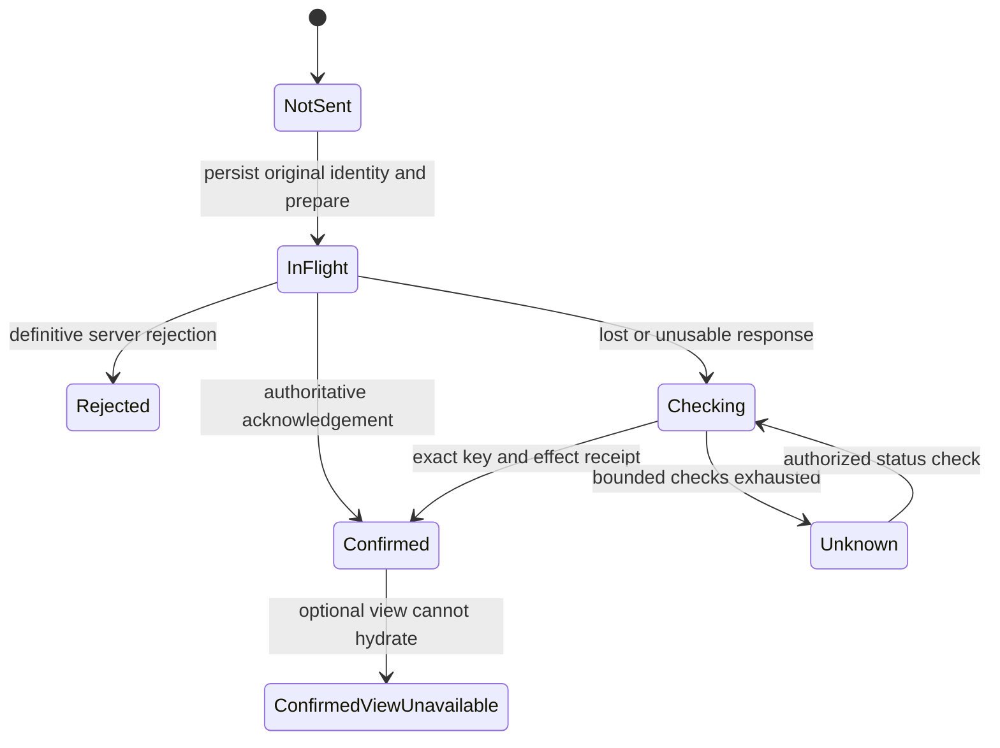
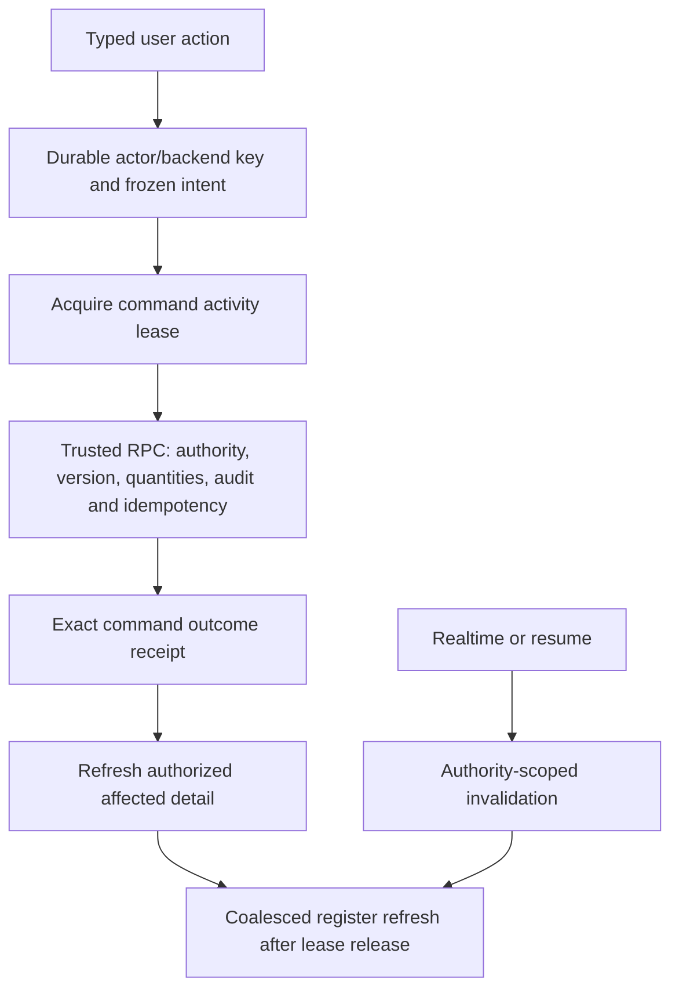

# P0 command outcomes and approval cancellation — 15 October 2026

Status: **implemented; staging database verification passed; final client and
production release gates pending**. The product owner subsequently authorized
production release with “Let's push these fixes to production right away.”
That explicit instruction supersedes the attached repair prompt's initial
read-only production boundary. It does not waive verification or authorize
load testing or synthetic business mutations in production.

The supplied incident evidence, production review and two repair prompts define
this focused repair. Their observations and proposed causes are treated as
separate evidence. This document records verified mechanisms, implementation,
remaining checks and release identity; it does not promise outage-free operation.

## 1. Verified release baseline

At preflight, `https://yorks-r35.vercel.app` resolved to deployment
`dpl_CjwmNd7DKHTzSbrwJ4uYXRcLQPb3`, source
`7177d887ec270780cb7802cb1c46c8a2050f865b`. Its database already included the
9 October approval-response adapter. The live `main.dart.js` SHA-256 was
`cc3bb48e560363e2eeaee36abfc474ee0cb5832d013247ca5802185cb8bbd489`.

The 11 October table-width candidate was uploaded but never promoted. The repair
branch, `codex/p0-truthful-command-outcomes-20261015`, starts at reviewed
`0ce6380`, preserving that table correction and the released Procurement work.
`main` at `6c73471` diverges from this release lineage and is not used as the
production baseline. Remote `5d81cef` differs from local `0ce6380` only in three
unrelated configuration/font changes; those are excluded. The primary checkout's
unrelated dirty work remains preserved in place.

| Target | Identity | Use in this repair |
|---|---|---|
| Local | Isolated worktree and `supabase_db_material_ledger` | Deterministic tests, independent-session races and synthetic read benchmark |
| Staging | Supabase `iqltcyimlqtcwyzlemwx` | Five additive migrations, rollback-only assertions and bounded read checks |
| Production | Supabase `czykuksmlwswjsgotrpo`; Vercel `yorks-r35` | Read-only preflight, followed by the owner-authorized release after final gates |

## 2. Incident findings and limits of attribution

| Evidence | What it establishes | What remains unproven |
|---|---|---|
| 13 October dispatch audit and durable dispatch alongside a client failure | The dispatch committed even though the client recorded failure | Whether the original response was lost, unusable or decoded incorrectly |
| Shared command boundary inspection and injected cleanup failures | Local key retirement could throw after acknowledgement | That this was the exact cause of the historical dispatch incident |
| 15 October `57014` in synchronous private-recovery archival | Approval was cancelled in that path; the inspected window contains no matching committed approval | The production lock holder and cancellation trigger |
| Local two-session archival reproduction | A contended recovery row can cancel the old approval path; the new path avoids that reproduced wait | That every production cancellation has the same mechanism |
| 14 October paired read failures | Reads failed or timed out | The precise browser, network, gateway or database contribution |
| 12 October permission and validation rejections | The server rejected the requests | That those rejections were incorrect; existing checks remain authoritative |
| Successful large upload | The transfer completed despite taking time | That a longer successful operation is itself a failure |

No timeout limits, permissions, quantity caps or workflow ownership rules are
relaxed to make failures disappear.

## 3. Command truth and user experience

The client distinguishes these phases:

- A missing receipt is **unknown**, never proof that an in-flight transaction
  cannot still commit. The editor retains the original key and frozen intent.
- Unknown and checking states use neutral feedback and a status action. A known
  commit stays successful when a view refresh, navigation or local cleanup fails.
- Prepared arrangement and dispatch recovery use the existing server intent
  ledger, with up to four automatic checks claimed atomically across tabs and
  devices. The exact audit effect identifies the dispatch, rather than whichever
  dispatch happens to be latest.
- Generic workflow recovery retains the existing durable key store. Its automatic
  budget is device-local. Approval restores its bounded checks after remount;
  receipt recovery offers a read-only status action for a retained pending key.
  Receipt form input is not reconstructed from that key after reload.
- MR submission performs bounded receipt reads after an ambiguous initial result.
  Project create/update/activate reuse their existing journal, payload and key;
  their existing mutation-attempt cap remains in place and status checks remain
  possible after that cap.
- No new business outbox is introduced. The existing global connectivity badge
  describes connection/sync state; it is not proof that a specific command failed
  or committed.

### Read and invalidation ordering

Register, summary and related protected reads coordinate with active command
leases. Realtime invalidations coalesce. A transient read failure may retain an
already authorized cached projection with a stale notice and bounded retry. An
explicit denial clears that projection immediately. Authority changes invalidate
late callbacks; an actor's receipt never authorizes another actor or scope.

## 4. Implementation map

Paths below are relative to the repository root.

| Slice | Principal implementation |
|---|---|
| Shared outcome phases and typed degraded/unknown results | `lib/shared/models/yorks_v1_command_outcome.dart` |
| Generic command key, single flight, exact readback, approval restore and receipt status | `lib/shared/controllers/yorks_v1_material_workflow_command_controller.dart`; `lib/shared/services/yorks_v1_critical_command_key_store.dart`; `lib/shared/repositories/yorks_v1_command_outcome_repository.dart` |
| MR submission recovery | `lib/shared/controllers/yorks_v1_material_request_draft_controller.dart` |
| Prepared arrangement/dispatch reconciliation and presentation | `lib/shared/controllers/yorks_v1_procurement_progress_controller.dart`; `lib/shared/repositories/yorks_v1_procurement_progress_repository.dart`; `lib/shared/widgets/yorks_v1_procurement_progress_panel.dart` |
| Project setup reconciliation and pending UI | `lib/shared/controllers/yorks_v1_project_setup_coordinator.dart`; `lib/features/projects/presentation/widgets/yorks_v1_project_setup_pending_recovery.dart` |
| Read activity and protected caching | `lib/shared/sync/yorks_v1_read_activity_gate.dart`; `lib/shared/sync/yorks_v1_protected_read_coordinator.dart`; affected MR/arrangement providers |
| Upload metadata, exact-file retry and acknowledged/degraded results | `lib/shared/services/yorks_v1_document_upload_journal.dart`; `lib/shared/repositories/yorks_v1_documents_repository.dart`; project setup coordinator and document consumers |
| Privacy-safe diagnostics | `lib/shared/models/analytics_event.dart`; `lib/shared/services/analytics_service.dart`; command, submission, arrangement, logistics and upload call sites |

### Additive migrations, in order

| Migration | Purpose |
|---|---|
| `20261015080249_bound_progressed_material_request_recovery_archival.sql` | Nonblocking archival trigger with durable, server-only queue and bounded cron worker |
| `20261015080348_material_workflow_command_outcomes.sql` | Actor-owned exact command receipt, followed by an optional current authorized projection |
| `20261015080635_procurement_truthful_outcome_reconciliation.sql` | Existing prepared intent recovery metadata, shared automatic-check budget and exact effect receipt |
| `20261015081241_p0_register_permission_graph_memoization.sql` | Resolve unchanged capability dependencies once per project in the unified register |
| `20261015091400_p0_project_command_outcome_lookup.sql` | Read-only actor-owned project command witness with current authorized projection |

Apply migrations before the matching client. Existing RPC signatures remain
available to released clients. The archival queue contains preservation
obligations, not a second workflow or stock authority. Normalized MR progression
continues to fence stale private edits while archival is deferred.

## 5. Authorization and data preservation

| Boundary | Retained behavior and evidence |
|---|---|
| Exact roles and project visibility | Existing protected resolvers remain authoritative; 642 permission-map parity checks cover all nine roles, active/archived/unassigned scopes, explicit grants/denials, dependency denials and shadow/enforced behavior |
| Commercial response shapes | Lookup checks current access and returns current authorized projections; it does not replay an old commercial payload after capability changes |
| Receipt ownership | Outcomes are scoped to the authenticated command actor and exact command/key; missing, other-actor, inactive and anonymous cases are tested |
| Critical writes | Existing server actor/version/state/quantity checks, request locks, idempotency and append-only effects remain in force |
| Private recovery | Original JSON, unknown fields and owner attribution are preserved in the existing archive; employee roles cannot access the queue or run its worker |
| Uploads | Recovery metadata is actor/backend-scoped and stores no file bytes, Storage path, notes or commercial content; changed file content cannot replace an unresolved intent |

The existing controlled-document limit remains **20 MiB**. Interrupted 10/20 MiB
synthetic transfers and rejection of a 50 MiB selection are covered without
raising that cap.

## 6. Verification recorded so far

### Database and concurrency

- Final clean local reset with all five migrations: **4,558 assertions across
  135 files passed**.
- Staging: all five migrations applied; **782 rollback-only assertions passed**:
  archival 21, workflow outcome/clarification 40, prepared Procurement 66,
  permission-map parity 642 and project outcome 13. Business fixtures rolled back.
- The independent-session archival harness reproduced the old failure at about
  772 ms under its 700 ms test timeout, then confirmed approvals at 89/91 ms
  despite the 1.5-second competing hold. These are local Docker measurements.
- Prepared Procurement tests cover a shared automatic-check slot, a lookup while
  dispatch is uncommitted, exact later receipt, abandonment fencing, and absence
  of duplicate dispatch, stock or audit effects.

### Read performance

The local benchmark used 30 projects, 600 Project MRs and 2,400 lines with
independent sessions at 5/10/20/30 concurrency. All **390 RPCs** completed without
errors or statement timeouts. Register EXPLAIN execution was 175.775 ms before and
95.582 ms after; shared-buffer hits fell from 39,451 to 18,925. This is a warm
local read benchmark, not a production latency promise or a mixed-write test.
See [the full register evidence](evidence/p0-20261015/REGISTER_READ_EVIDENCE.md).

Staging performed **195 read operations with zero errors** in tool batches of
5/10/20/30. The MCP calls were not barriered database sessions and may serialize;
this is **not proof of 30 simultaneous database sessions**. Reported server P95
values ranged from 72.988 to 94.873 ms and exclude browser/network/tool overhead.
Samples are retained in [staging-read-load.json](evidence/p0-outcomes-20261015/staging-read-load.json).

### Client and visual checks

Focused command, recovery, project, upload and protected-read suites passed.
New desktop 1366 px and phone 360 px goldens cover checking, unknown, confirmed,
reconciled dispatch and upload status. Existing relevant mobile/register goldens
were also checked. Final whole-suite, analyzer, web/APK build and production
artifact checks are recorded below only when completed.

[Approval and upload evidence](P0_APPROVAL_ARCHIVAL_UPLOAD_EVIDENCE_20261015.md)
records reproduction commands, preservation details and synthetic-transfer limits.

## 7. Remaining coverage limits

- Deterministic tests and goldens do not constitute real Windows Edge/Chrome,
  Android Chrome/PWA, native iOS, slow physical transfer or warehouse UAT.
- The separate Company Use command screens/repositories were not rewritten into
  this Project MR recovery path. This release does not claim universal command
  recovery across the application.
- Generic automatic budgets are device-local; prepared Procurement budgets are
  server-claimed. Receipt input itself is not durably reconstructed after reload.
- The native storage adapter serializes within one application process;
  independent native processes were not given browser Web Locks guarantees.
- The read benchmark excludes simultaneous critical writes and production load.
  Historical incident counts remain historical evidence, even after a command
  is later reconciled as committed.

## 8. Production release record — pending

Production mutation is authorized by the latest user instruction. Populate these
fields only from the final release's actual outputs; a Git push or an uploaded
candidate alone does not prove that the canonical alias is live.

| Release gate or identity | Result |
|---|---|
| Final source commit and remote branch | **PENDING** |
| Final `flutter pub get`, changed-file formatting and `flutter analyze` | **PENDING** |
| Final full `flutter test` | **PENDING** |
| Final clean `supabase db reset` and `supabase test db` | PASS: 4,558 assertions / 135 files |
| CI web/startup-budget build | PASS: startup gzip 2,874,144 bytes, under 2,900,000 bytes |
| CI ephemeral-signed APK verification build | PASS: release build, 113.5 MB; not a distribution artifact |
| Production migration ledger and function verification | **PENDING** |
| Production web artifact/configuration/hash verification | **PENDING** |
| Immutable deployment ID and URL | **PENDING** |
| Candidate verification and canonical alias/hash checks | **PENDING** |
| Read-only post-release smoke checks | **PENDING** |

### Rollback

Preserve the previous immutable client deployment identified in section 1. A
client rollback must retain pending recovery metadata and its original keys.
Older clients may quarantine newer device metadata rather than consume it;
preserve that copy and its server checkpoint for forward recovery.

Use a corrective migration to restore a prior function only when required.
For register performance rollback, restore the reviewed register function from
`20260928144343_optimize_unified_material_request_register_setwise.sql`, then
remove the unused internal map helper. Keep the archival queue, worker, fences,
archive and all pending obligations until safely drained. Never reverse business
transitions, delete receipts/audit, erase unknown intent, or mint a replacement
key merely to undo a presentation problem.

### Low-cost post-release observation

1. Verify production migration identities, function grants and the archival cron
   job; inspect bounded queue age/retry counts and recent job outcomes using the
   queries in the approval/upload evidence.
2. Verify the canonical alias serves the exact reviewed artifact and production
   backend configuration; retain the prior deployment as the rollback target.
3. Correlate new privacy-safe command phases with exact server receipts and audit
   when investigating a failure. Separate transport failure from later command
   confirmation and optional view failure. Do not rewrite historical telemetry.
4. Inspect fresh, bounded read/error/latency aggregates by release and originating
   screen. Do not generate business mutations or production load to prove a fix.
5. Record real-user or physical-browser issues as separate evidence and improve
   the implementation when the evidence warrants it.
